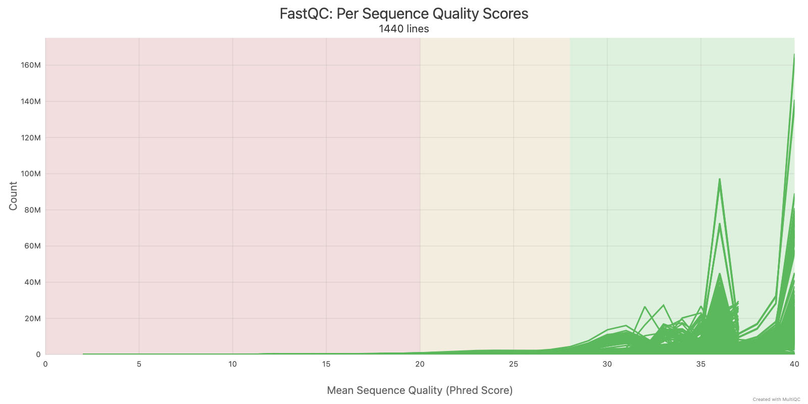
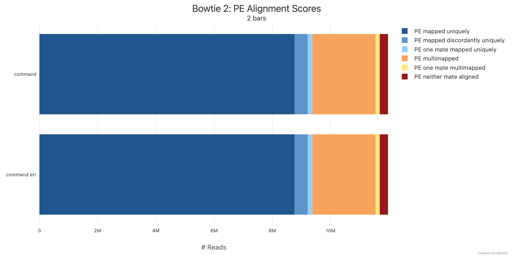
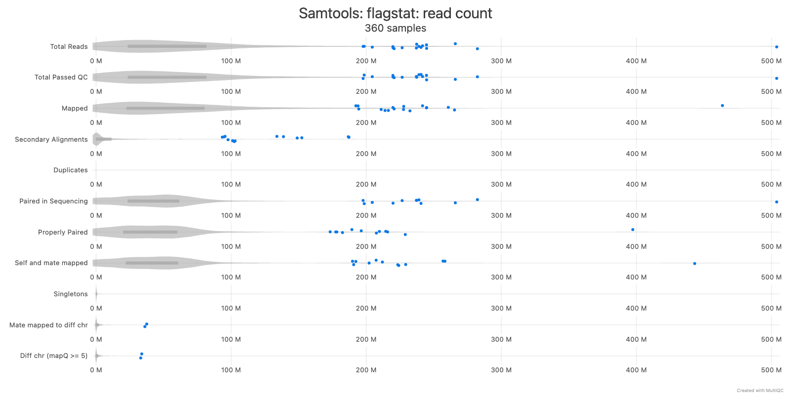
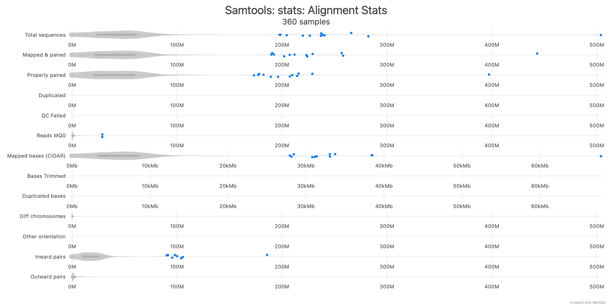

# Cell-Free Multi-Omics Analysis in Gastrointestinal Cancer

<p align="center">
  
</p>

An automated, HPC-ready Nextflow DSL2 workflow designed for high-throughput, multi-modal liquid biopsy deconvolution. Serving as a scalable, transparent reproduction of 
Tao et al. (2023, Cell Reports Medicine), the pipeline orchestrates raw read preprocessing, layer-specific alignment (Bowtie2 & STAR), deduplication, fragment-length distributions, synthetic ERCC/ribosomal RNA accounting, and unique molecular identifier (UMI) deduplication across four distinct plasma cell-free sequencing modalities (86 cfWGS, 98 cfMeDIP, 127 total cfRNA, and 49 small cfRNA libraries) in gastrointestinal malignancies and healthy donors.

---
## Research Team

**Horizon Science Communication LLC — Bioinformatics Team**

- **Hesham Abdullah, PhD**
- **Noura Khaled**

---

## Project Background

Gastrointestinal (GI) cancers, including colorectal cancer (CRC) and stomach adenocarcinoma (STAD), represent major challenges in cancer detection and molecular characterization. Identifying reliable molecular features in blood samples may support the development of less invasive approaches for cancer research and biomarker discovery.

Cell-free DNA (cfDNA) and cell-free RNA (cfRNA) circulating in blood can carry molecular information associated with underlying biological and disease processes. However, individual molecular layers capture different aspects of cancer biology and may provide complementary information.

This project investigates a cell-free multi-omics approach by analyzing publicly available sequencing datasets across colorectal cancer, stomach adenocarcinoma, and healthy donor groups. The study incorporates whole-genome sequencing of cfDNA (cfWGS), methylated cfDNA profiling (cfMeDIP-seq), total cfRNA sequencing, and small cfRNA sequencing for miRNA profiling.

By characterizing these molecular layers, the project aims to investigate cancer-associated genomic, epigenetic, and transcriptomic patterns and explore their potential biological relevance.

---

## Project Objectives

The main objective of this project is to characterize cell-free molecular profiles across colorectal cancer, stomach adenocarcinoma, and healthy donor groups using a multi-omics bioinformatics workflow.

The specific objectives are to:

- Characterize cfDNA genomic alterations, with a focus on copy-number variation (CNV) features.
- Investigate complementary cfDNA fragmentomic features, including end-motif patterns and fragment-size profiles.
- Profile DNA methylation patterns using cfMeDIP-seq data.
- Quantify gene expression from total cfRNA-seq data and investigate relevant RNA features.
- Characterize small cfRNA-derived miRNA profiles and explore their biological relevance.
- Integrate selected genomic, methylation, and gene-expression features to investigate cross-omics relationships and biologically relevant pathways.
- Explore molecular signatures that may support future biomarker discovery in gastrointestinal cancers.
  
---

## Why Multi-Omics Integration?

Cancer involves interconnected genomic, epigenetic, and transcriptomic alterations. Analyzing these molecular layers together may provide a more comprehensive view of cancer biology than examining each layer independently.

This project integrates selected features from three core layers:
- **cfWGS:** Copy-number variations (CNVs).
- **cfMeDIP-seq:** DNA methylation patterns.
- **Total cfRNA-seq:** Gene-expression profiles.

Combining these complementary features may reveal cross-omics relationships and biologically relevant cancer-associated patterns. Fragmentomic and miRNA features are investigated separately to provide additional molecular insights.

---

## Study Questions

- Can liquid biopsy-derived molecular features support the early detection of CRC, particularly at stages I–II, compared with healthy donors?
- Which molecular features distinguish CRC and STAD from healthy donors, and which are cancer-type-specific?
- How are genomic, epigenetic, and transcriptomic alterations related across the three core omics layers?
- Which biological pathways and molecular signatures emerge from multi-omics integration?
- What additional disease-associated information can be captured through cfDNA fragmentomic and small cfRNA-derived miRNA profiles?
  
---

## Study Design

| Parameter | Details |
|---|---|
| **Participants** | 161 individuals: 44 CRC · 36 STAD · 81 healthy donors |
| **Datasets** | 360 published (352 after QC) |
| **GEO Series** | [GSE186607](https://www.ncbi.nlm.nih.gov/geo/query/acc.cgi?acc=GSE186607) |
| **Disease focus** | Colorectal cancer (CRC) and gastric cancer (STAD) |

---

## Omics Layers

| Layer | Description | Datasets | BioProject |
|---|---|---|---|
| **cfWGS** | Whole-genome sequencing of cfDNA — copy-number and fragmentomic features | 86 | [PRJNA774626](https://www.ncbi.nlm.nih.gov/bioproject/PRJNA774626) |
| **cfMeDIP-seq** | Antibody-enriched methylated cfDNA — promoter and CpG-island methylation | 98 | [PRJNA774625](https://www.ncbi.nlm.nih.gov/bioproject/PRJNA774625) |
| **Total cfRNA-seq** | Long and short cfRNA — gene expression, splicing, chimeric RNA | 127 | [PRJNA774661](https://www.ncbi.nlm.nih.gov/bioproject/PRJNA774661) |
| **Small cfRNA-seq** | Small RNA / miRNA profiling (QIAseq, UMI-based) | 49 | [PRJNA774739](https://www.ncbi.nlm.nih.gov/bioproject/PRJNA774739) |

---
### Nextflow workflow automation

Processing multi-layer liquid biopsy data involves coordinated quality control, layer-specific adapter trimming, aligner optimization, contaminant deconvolution, and downstream quantification across 360 paired-end libraries. Nextflow (DSL2) organizes these tasks into a modular, reproducible workflow with strict process dependencies and resource management.

In this project, Nextflow supports:

- **Multi-omics orchestration:** coordinates raw read pre-processing, QC, genome alignment, contaminant profiling, and feature quantification across four distinct circulating layers:
  - **cfWGS / cfDNA (86 samples):** FastQC, Trim Galore (`AGATCGGAAGAGC`), Bowtie2 (end-to-end), Picard MarkDuplicates, and Picard InsertSizeMetrics (fragmentomics).
  - **cfMeDIP-seq (98 samples):** fastp (poly-G trimming/Q20 correction), Bowtie2 against unconverted GRCh38, Phage Lambda screen, and subread featureCounts across 10.3M 300-bp genomic windows.
  - **Total cfRNA-seq (127 samples):** Cutadapt (`-m 20`), STAR alignment with BAM sorting memory optimization (`--limitBAMsortRAM 30GB`), featureCounts against protein-coding/lncRNA genes, and a parallel Bowtie2 mini-spikein panel for ERCC and rRNA quantification.
  - **Small cfRNA-seq (49 samples):** custom streaming QIAseq 3′ adapter clipping (`AACTGTAGGCACCATCAAT`), 12-nt random UMI extraction, Bowtie2 alignment to miRBase mature microRNAs, and PCR deduplication.
- **Large-scale multi-sample processing:** processes 360 high-depth 2×150 bp paired-end plasma libraries across Colorectal Cancer (CRC, n=115), Stomach Adenocarcinoma (STAD, n=119), and Healthy Donors (HD/NC, n=126).
- **Spike-in & contaminant deconvolution:** isolates in-silico ERCC control dynamics (~2.7% mean) and per-sample rRNA depletion variation (0.2%–52.6%) to supply technical covariates for downstream differential expression (DESeq2 / RUVg).
- **HPC cluster execution:** distributed execution across heterogeneous compute nodes managed via SLURM (`sbatch` / job arrays) with optimized CPU, memory, and wall-time allocations.
- **Fault-tolerant resume & caching:** leverages Nextflow’s content-addressable cache (`-resume`) to recover from task interruptions, retry failed jobs with dynamic resources, and prevent re-computation of verified upstream alignments.

Tool dependencies are provisioned via environment modules (Lmod) for core aligners (`star/2.7.3a`, `bowtie2/2.2.7`, `samtools/1.21`, `subread/2.0.5`, `gatk/4.2.6.1`, `bedtools/2.27.1`) alongside dedicated Conda environments for `trimgalore`, `multiqc_env`, `blast_env`, and R statistical packages (`rnaseq_r`, `DESeq2`, `edgeR`, `MEDIPS`).

---
## Pipeline Architecture

The workflow is implemented in **Nextflow DSL2** and runs on **SLURM HPC**. All four omics branches are executed in parallel within a single `nextflow run` invocation.

```
main.nf
 ├── cfWGS branch          fasterq-dump → FastQC → Trim Galore → Bowtie2 → Samtools → GATK MarkDuplicates → Picard insert size
 ├── cfMeDIP-seq branch    fasterq-dump → FastQC → fastp → Bowtie2 → Samtools → GATK MarkDuplicates → 300-bp bin counts
 ├── Total cfRNA branch    fasterq-dump → FastQC → Cutadapt → STAR (GRCh38) → featureCounts · ERCC (Bowtie2) · rRNA (Bowtie2) → spikein QC
 └── Small cfRNA branch    fasterq-dump → FastQC → Trim Galore → Bowtie2 (miRBase hsa_mature) → UMI deduplication → miRNA counts
```

Supporting modules: `main_downstream.nf` · `main_spikein.nf` · `main_smallrna.nf`

---

## Current Outputs

| Layer | Output | Size / Notes |
|---|---|---|
| cfWGS | 86 aligned BAM files + indexes; 86 MarkDuplicates reports; Picard insert-size reports; Samtools flagstat/idxstats/stats | — |
| cfMeDIP-seq | 98 aligned BAM files + indexes; 300-bp bin count matrix | — |
| Total cfRNA-seq | `totalrna_gene_counts.txt` (protein-coding + lncRNA); `ercc_counts_matrix.tsv` (92 ERCC × 127); `spikein_qc_summary.tsv` | ~52 MB counts; mean ERCC ≈ 2.66%, mean rRNA ≈ 8.66% |
| Small cfRNA-seq | `mirna_counts_matrix.tsv` (1,402 mature miRNAs × 49 samples) | UMI-deduplicated |

---

## Results Showcase

This section presents selected quality control and alignment results generated during the completed stages of the project. The results are organized according to the processing workflow.

### 1. Initial Sequencing QC and Alignment

This stage includes initial sequencing quality assessment and read alignment using FastQC, Bowtie2, and STAR.

#### 1.1 FastQC – Per Sequence Quality Scores

Shows the distribution of average sequence quality scores across reads, helping assess overall sequencing quality.



#### 1.2 Bowtie2 – Paired-End Alignment

Presents the paired-end read alignment results generated by Bowtie2.



#### 1.3 STAR Alignment Summary

Summarizes the alignment statistics generated by STAR.


---

### 2. Downstream BAM Processing and Quality Control

This stage presents selected quality control metrics obtained during downstream BAM processing, including duplicate marking, insert size assessment, and alignment statistics.

#### 2.1 Picard – Duplicate Marking Metrics

Summarizes duplicate reads identified during BAM processing.


#### 2.2 Picard – Insert Size Distribution

Shows the distribution of insert sizes among aligned paired-end reads.


#### 2.3 Samtools – Flagstat Summary

Provides alignment statistics, including mapped and unmapped reads and pairing information.



#### 2.4 Samtools – Depth Statistics

Presents sequencing depth-related statistics obtained from Samtools.



---

**Note:** The results shown above represent completed quality control and alignment stages. Further downstream analyses, including feature extraction, statistical analysis, feature selection, and multi-omics integration, are still in progress.

---

## Planned Downstream

Downstream analysis will involve feature extraction, statistical analysis, and feature selection within each omics layer to identify informative molecular features.

- **cfWGS:** Characterization and selection of CNV features, alongside complementary fragmentomic analyses.
- **cfMeDIP-seq:** Identification and selection of informative DNA methylation features.
- **Total cfRNA-seq:** Differential gene-expression analysis and selection of informative transcriptomic features.
- **Small cfRNA-seq:** Characterization and selection of miRNA features, analyzed as a separate branch.

Selected CNV, methylation, and gene-expression features will then be integrated using ActivePathways to investigate cross-omics relationships and enriched biological pathways, followed by network visualization in Cytoscape.

Small cfRNA/miRNA and complementary fragmentomic analyses will remain separate from the core ActivePathways integration.

---

## Repository Structure

```
cellfree-multiomics-gi-cancer/
├── main.nf                        # Nextflow entry point; orchestrates all four branches
├── nextflow.config                # Cluster execution profile (select with -profile cluster)
├── submit_multiomics.sh           # SLURM launcher (1 node, 1 CPU, 16 GB, 120 h)
├── workflows/
│   ├── main_downstream.nf         # Downstream feature generation (CNV, fragmentomics)
│   ├── main_spikein.nf            # ERCC and rRNA spike-in QC module
│   └── main_smallrna.nf           # Small cfRNA / miRNA processing module
├── submit_smallrna.sh             # SLURM launcher for small RNA branch
├── submit_smallrna_array.sh       # Array SLURM launcher for small RNA
├── submit_spikein.sh              # SLURM launcher for spike-in QC module
├── envs/
│   ├── cfwgs.yml                  # Conda environment: cfWGS tools
│   ├── cfmedip.yml                # Conda environment: cfMeDIP-seq tools
│   ├── totalrna.yml               # Conda environment: total cfRNA tools
│   └── smallrna.yml               # Conda environment: small cfRNA / miRNA tools
├── sample_sheets/
│   ├── cfwgs_samplesheet.csv      # SRA run table: cfWGS (86 samples)
│   ├── cfmedip_samplesheet.csv    # SRA run table: cfMeDIP-seq (98 samples)
│   ├── totalrna_samplesheet.csv   # SRA run table: total cfRNA (127 samples)
│   └── smallrna_samplesheet.csv   # SRA run table: small cfRNA (49 samples)
├── scripts/
│   └── umi_dedup.py               # UMI-based deduplication for miRNA counting
├── docs/
│   └── workflow_overview.md       # Detailed methods and parameter notes
└── .gitignore
```

---

## Usage

### Prerequisites

- Nextflow ≥ 22.10
- Conda / Mamba
- SLURM workload manager
- ~2 TB scratch space for all four branches

### Quick start

```bash
# Clone
git clone https://github.com/HABIOTECH/cellfree-multiomics-gi-cancer.git
cd cellfree-multiomics-gi-cancer

# Submit all four branches
sbatch submit_multiomics.sh

# Resume after interruption
nextflow run main.nf -c nextflow.config -profile cluster -resume \
  --cfwgs_samplesheet    sample_sheets/cfwgs_samplesheet.csv \
  --cfmedip_samplesheet  sample_sheets/cfmedip_samplesheet.csv \
  --totalrna_samplesheet sample_sheets/totalrna_samplesheet.csv \
  --smallrna_samplesheet sample_sheets/smallrna_samplesheet.csv
```

---

## Tools and References

| Tool | Version | Use |
|---|---|---|
| Nextflow | DSL2 | Workflow orchestration |
| fasterq-dump (SRA-tools) | — | FASTQ generation from SRA |
| FastQC | — | Per-sample QC |
| Trim Galore | — | Adapter trimming (cfWGS, small cfRNA) |
| fastp | — | Adapter trimming (cfMeDIP-seq) |
| Cutadapt | — | Adapter trimming (total cfRNA) |
| Bowtie2 | — | Alignment: cfWGS, cfMeDIP-seq, ERCC, rRNA, miRNA |
| STAR | — | Splice-aware alignment: total cfRNA (GRCh38) |
| Samtools | — | BAM sorting, indexing, QC |
| GATK MarkDuplicates | — | Duplicate marking |
| Picard | — | Insert-size distribution |
| featureCounts | — | Gene quantification (total cfRNA) |
| miRBase (hsa_mature) | — | miRNA reference (small cfRNA) |
| GRCh38 | 2024-A / GENCODE v44 | Human reference genome |

---

## Human-in-the-Loop AI-Assisted Development

This pipeline was developed with AI assistance (Claude Code) for literature review, Nextflow script drafting, SLURM log interpretation, and workflow debugging. All scientific decisions, HPC execution, output verification, and QC interpretation were performed by the researcher. AI did not run the pipeline or validate results independently.

---
## Dataset

The case study uses cell-free multi-omics sequencing data associated with Tao et al. (2023), comprising **360 biological libraries** across four distinct liquid biopsy layers:

| Layer | Assay / Platform | Samples ($N$) | BioProject | SRA Study | GEO Sample Range |
| :--- | :--- | :---: | :---: | :---: | :---: |
| **cfDNA** | Whole-genome sequencing (HiSeq X Ten, PE 150) | 86 | [PRJNA774626](https://www.ncbi.nlm.nih.gov/bioproject/PRJNA774626) | [SRP343169](https://trace.ncbi.nlm.nih.gov/Traces/?view=study&acc=SRP343169) | GSM5655902 – GSM5655987 |
| **cfMeDIP** | Methylated DNA immunoprecipitation (HiSeq X Ten, PE 150) | 98 | [PRJNA774625](https://www.ncbi.nlm.nih.gov/bioproject/PRJNA774625) | [SRP343170](https://trace.ncbi.nlm.nih.gov/Traces/?view=study&acc=SRP343170) | GSM5656000 – GSM5656097 |
| **total cfRNA** | Total RNA-seq + ERCC spike-in (HiSeq X Ten, PE 150) | 127 | [PRJNA774661](https://www.ncbi.nlm.nih.gov/bioproject/PRJNA774661) | [SRP343186](https://trace.ncbi.nlm.nih.gov/Traces/?view=study&acc=SRP343186) | GSM5656685 – GSM5656829 |
| **small cfRNA** | QIAseq miRNA + 12-nt UMI (HiSeq X Ten, SE 75) | 49 | [PRJNA774739](https://www.ncbi.nlm.nih.gov/bioproject/PRJNA774739) | [SRP343188](https://trace.ncbi.nlm.nih.gov/Traces/?view=study&acc=SRP343188) | GSM5657238 – GSM5657286 |
| **Total** | **Multi-layer cell-free profile** | **360** | — | — | — |

### Cohort Clinical Breakdown

- **Colorectal Cancer (CRC):** 115 samples
- **Gastric Cancer (STAD):** 119 samples
- **Non-Cancer Healthy Controls (NC):** 126 samples

## Reference

> Tao Y, Xing S, Zuo S, et al. **Cell-free multi-omics analysis reveals potential biomarkers in gastrointestinal cancer patients' blood.** *Cell Reports Medicine* 2023;4(11):101281. DOI: [10.1016/j.xcrm.2023.101281](https://doi.org/10.1016/j.xcrm.2023.101281)

---

## Contributors and Affiliation

This project was conducted by **Dr. Hesham Abdullah** and **Noura Khaled**, and is affiliated with **Horizon Science Communication LLC**.

**Dr. Hesham Abdullah**
- Email: `ceo@horizon-sci-comm.us and horizonsc.us@gmail.com`
- GitHub: [@HABIOTECH](https://github.com/HABIOTECH)
- LinkedIn: [Hesham Abdullah](https://www.linkedin.com/in/hesham-abdullah-40bab1190/)

**Noura Khaled**
- Email: `nourakhaledhussien@gmail.com`
- GitHub: [@nourakhaledhussien-code](https://github.com/nourakhaledhussien-code)
- LinkedIn: [Noura Khaled](https://www.linkedin.com/in/noura-khaled-211517234/)

---

### Organization

**Horizon Science Communication LLC**


🌐 [Website](https://www.horizon-sci-comm.us/)
---


## License

MIT License — see [LICENSE](LICENSE) for details.
